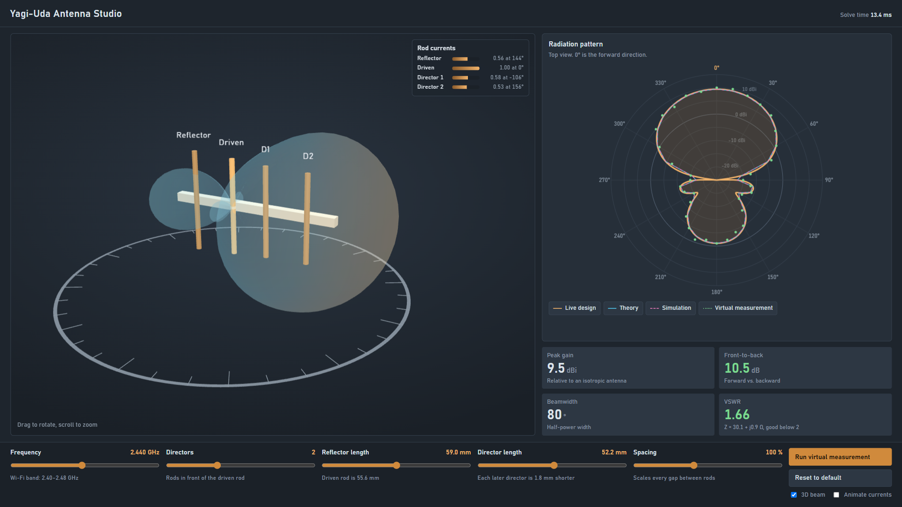

# 2.4 GHz Directive Phased & Parasitic Antenna Array
### EC-3104 Electromagnetic Theory — Team Capstone Project

Design, computational modeling, and experimental validation of a 2.44 GHz
4-element Yagi-Uda array with real-time beamforming and null-steering. The
project is **~85% software** (custom CEM solver + interactive GUI + full-wave
simulation) and **~15% low-cost hardware** validation.

> Full background, rubric, timeline, and task split: see
> [`emt_project_master_context_handoff_document.md`](emt_project_master_context_handoff_document.md)
> and the plain-language overview in [`docs/project_explained_simply.md`](docs/project_explained_simply.md).
>
> **Building the hardware next?** Start with the beginner-friendly, follow-along
> guide: [`docs/hardware_next_steps.md`](docs/hardware_next_steps.md).

---

## Antenna Studio: the live demo



A browser app that shows our Yagi in 3D and **solves its physics live** as you
change the design. Each rod glows with its induced current, the 3D beam
reshapes, and the polar pattern, gain, front-to-back, beamwidth and VSWR update
in ~10–20 ms. A **virtual turntable** measures the pattern point by point.

```bash
python run_pipeline.py --studio      # rebuild everything, then open the Studio
# or just open antenna_studio/antenna_studio.html (works offline)
```

The solver in [`antenna_studio/yagi_engine.js`](antenna_studio/yagi_engine.js) is
a port of the Lead's Python engine (induced-EMF method of moments), and is
verified against it on six designs to 0.0000 dB:

```bash
python antenna_studio/make_reference.py
node   antenna_studio/test_engine.js antenna_studio/py_ref.json   # ALL CHECKS PASSED
```

What every control does, and a full demo-video script:
[`docs/video_demo_guide.md`](docs/video_demo_guide.md).

---

## Repository layout

| Folder | Owner | Contents |
|---|---|---|
| [`Electromagnetic-Theory-Member-1-main/`](Electromagnetic-Theory-Member-1-main/) | **Project Lead + Member 1** | Analytical EM engine (`antenna_math_engine.py`) and interactive beamforming GUI (`antenna_gui.py`) |
| [`EMT_Member2/`](EMT_Member2/) | **Member 2** | 4nec2 model (`yagi_4el_244GHz.nec`), simulation export (`simulate_yagi.py`), Smith chart, PDF report builder |
| [`member3_hardware/`](member3_hardware/) | **Member 3** | Cutting-dimension & balun calculators, 3D assembly diagrams, protractor template, assembly guide |
| [`member4_telemetry/`](member4_telemetry/) | **Member 4** | Virtual measurement, Friis link budget, RSSI logger (phone or ESP32) |
| [`data/`](data/) | Shared | **Every file passed between members** (dimensions JSON, pattern CSVs) |
| [`emt_config.py`](emt_config.py) | Shared | Design constants (f0, λ, Z0) and the locations of the files in `data/` |
| [`antenna_studio/`](antenna_studio/) | Shared (demo) | Live 3D Yagi designer: browser solver, verification test, build script |
| [`run_pipeline.py`](run_pipeline.py) | Shared | Regenerates everything in the right order |
| [`docs/`](docs/) | Shared | Project explainer and supporting docs |

---

## Quick start

```bash
git clone <REPO_URL>
cd emt_project
pip install -r requirements.txt
```

Regenerate every member's outputs in dependency order (Member 2 → Member 3 → Lead → PDF):

```bash
python run_pipeline.py          # add --studio to open the live Antenna Studio at the end
```

Or run any single deliverable; scripts work from any folder:

```bash
python EMT_Member2/simulate_yagi.py                          # dimensions + simulated CSV + Smith chart
python Electromagnetic-Theory-Member-1-main/antenna_math_engine.py   # theory CSV + all Lead plots
python Electromagnetic-Theory-Member-1-main/antenna_gui.py   # interactive dashboard
python member3_hardware/dimension_calculator.py              # cutting blueprint
```

> Member 2's PDF builder needs `reportlab` (included in `requirements.txt`);
> the pipeline skips it if it isn't installed.

---

## How the members' work connects (data contracts)

Everything integrates through the shared [`data/`](data/) folder. Scripts find
it through `emt_config.py`, so there are no copies to keep in sync:

```
EMT_Member2/simulate_yagi.py ──► data/optimized_dimensions.json ──► Lead engine (Yagi solver)
                                                               └──► member3_hardware (blueprint)
EMT_Member2/simulate_yagi.py ──► data/simulated_pattern.csv   ──┐
Lead antenna_math_engine.py  ──► data/theoretical_pattern.csv ──┼──► Member 1 GUI overlay
Member 4 (RSSI sweep)        ──► data/empirical_pattern.csv   ──┘
```

1. **Universal radiation-pattern CSV** — `angle_deg,gain_dBi`, 36 rows (0°–350° in 10° steps),
   azimuth cut with **0° = main beam (toward the directors)**, 180° = reflector side.
2. **Optimized dimensions** — `data/optimized_dimensions.json` is the
   **single source of truth** for element lengths/spacings. The Lead's Yagi
   solver and Member 3's blueprint both read it.

If you change a design constant, edit it in `emt_config.py`; if you change the
antenna geometry, re-run `python run_pipeline.py` so every output updates.

---

## Team workflow (how to contribute)

Each member works primarily in **their own folder**, so day-to-day changes rarely collide.

1. Get the latest before you start:
   ```bash
   git pull
   ```
2. Work on your own branch (recommended), named after your role:
   ```bash
   git checkout -b member2            # e.g. member1, member2, member3, member4, lead
   # ... edit files in your folder ...
   git add EMT_Member2/
   git commit -m "Member 2: add frequency-sweep smith chart"
   git push -u origin member2
   ```
3. Open a Pull Request on GitHub to merge your branch into `main` (lets the team review), **or** if your team prefers, push small changes straight to `main`:
   ```bash
   git checkout main && git pull && git push
   ```

### Ground rules
- **Only edit your own folder** unless you've agreed otherwise — it avoids merge conflicts.
- **Read and write shared files only through `emt_config.py` paths** — never copy a CSV/JSON into your own folder.
- **Pull before you push.** If a push is rejected, run `git pull --rebase`, resolve, then push again.
- Don't commit `__pycache__/`, virtual envs, or editor files — they're already in `.gitignore`.
- Generated outputs (PNGs, CSVs, PDF) **are** tracked so the team sees results without re-running.

---

## Members & slide ownership

| Role | Focus | PPT slides |
|---|---|---|
| Project Lead | Analytical EM solver & integration | Title, Abstract, Working Principle, Math |
| Member 1 | Beamforming GUI & null-steering | Software Architecture, Beamforming Results |
| Member 2 | Full-wave simulation & S-parameters | Circuit Model, Design Steps, Sim Results |
| Member 3 | Hardware fabrication & mechanical rig | Components, Assembly, Prototype |
| Member 4 | Telemetry, field testing & video | Experimental Setup, Observations, Conclusion |
