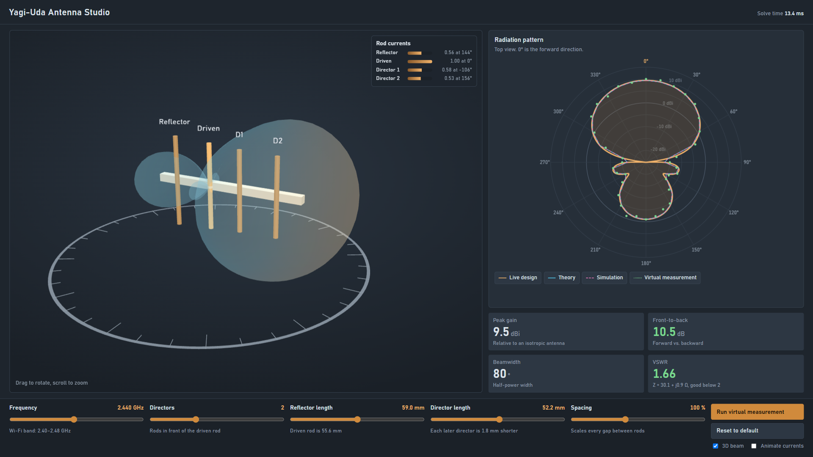

# Demo Video Guide

*A step-by-step script for recording the project demonstration (about 5 minutes).
It covers what to open, what to click, what to say, and what every part of the
screen means.*

> For an explanation of the project itself, see
> [`complete_project_guide.md`](complete_project_guide.md). This guide is only
> about presenting it.

---

## 0. What the video shows

The whole demonstration runs in the **Yagi-Uda Antenna Studio**, an interactive
app that opens in a web browser:



Everything on this screen is calculated live by the antenna solver whenever a
control changes:

- the antenna is shown in **3D** and can be rotated,
- each copper rod **glows** in proportion to the current flowing in it,
- the **radiation beam** is drawn around the antenna in 3D,
- the **polar plot** and the **four readouts** update instantly,
- a **virtual measurement** turns the antenna on a turntable and records its
  pattern point by point.

**The story of the video:**

> The antenna as a live 3D model → how its rods create a beam → what happens when
> the design changes → measuring it → proof that theory, an independent
> simulation and the measurement agree.

---

## 1. Before recording (checklist)

- [ ] Open a terminal in the project's main folder.
- [ ] Rebuild everything and open the Studio:
      ```bash
      python run_pipeline.py --studio
      ```
      Wait for all 9 steps to report **ok**; the Studio opens in the browser.
      (The Studio can also be opened directly by double-clicking
      `antenna_studio/antenna_studio.html`; it works offline.)
- [ ] In the browser, press **F11** (fullscreen) and **Ctrl+0** (100% zoom).
- [ ] Rehearse the experiments in Section 4 once, then press
      **Reset to default**.
- [ ] Open the slide deck `docs/demo_slides.html` in a second browser tab
      (title card, cue cards, closing card and backup slides).
- [ ] Screen recorder: OBS Studio (free) or Windows Xbox Game Bar (`Win + G`).
      Record at 1080p.
- [ ] Microphone check: record 5 seconds and play it back.
- [ ] Close notifications, chat apps and unused browser tabs.
- [ ] If `python` cannot find numpy, use the full interpreter path instead:
      `C:\Users\imamr\AppData\Local\Programs\Python\Python312\python.exe`

> **Tip:** record one scene at a time. A fumbled scene can simply be recorded
> again and the clips joined afterwards.

---

## 2. The Studio screen, part by part

Read this once before recording. It lets the presenter *explain* the screen rather
than only show it, and it covers what evaluators are likely to ask about.

### 2.1 Header

- **Solve time (e.g. "18.6 ms")**: every change makes the app re-solve the antenna
  physics from scratch. This shows the calculation is live and how long it took.

### 2.2 3D view (left)

| On screen | Meaning |
|---|---|
| **Copper rods** labelled *Reflector, Driven, D1, D2…* | The antenna, at its exact lengths and spacings. |
| **Pale bar** under the rods | The **boom**. It is non-metal (wood/plastic), so it does not disturb the signal. |
| **Bright dot** in the middle of the *Driven* rod | The **feed point**, where the radio signal is connected. The rod has a small gap there. |
| **Glow** of each rod | The **current** in that rod. Only the driven rod is fed; the others glow because they pick up energy from it. |
| **Translucent balloon** around the antenna | The **3D radiation beam**: signal strength in every direction. A large bulge means a strong beam in that direction. |
| **Ring with tick marks** below | The **turntable**, marked every 10°, used by the virtual measurement. |

**Mouse:** drag to rotate the view, scroll to zoom. This only moves the camera,
not the antenna.

### 2.3 Rod currents panel (top right of the 3D view)

Each row shows a rod's current as a **bar** and as two numbers, e.g.
**"0.58 at −106°"**:

- **0.58**: the rod carries 58% of the driven rod's current.
- **−106°**: its current is **delayed** relative to the driven rod. This is how far
  behind the driven rod it is in the wave.

**Why it matters:** the waves from all rods add together. Because each rod's
current is delayed by a particular amount, the waves **arrive in step toward the
directors** (they add up, giving a strong beam) and **out of step toward the
reflector** (they cancel, giving a weak back). This panel shows the mechanism
that creates the beam.

### 2.4 Radiation pattern (polar plot, top right)

This is the 3D beam seen from directly above.

- **Angles around the edge:** directions around the antenna. **0° (top) is
  forward**, the direction the directors point. **180°** is straight behind.
- **Rings (10, 0, −10, −20 dBi):** signal strength. Further from the centre means
  stronger. Rings are 5 dB apart (every 3 dB is double the power).
- **Shape:** a large lobe at the top is the forward beam; a small lobe at the
  bottom is what leaks backward.

**The four curves (legend chips below the plot):**

| Chip | Line | What it is |
|---|---|---|
| **Live design** | thick copper, shaded | The design currently set on the controls, calculated live. |
| **Theory** | thin cyan | The analytical engine's prediction for the default design (2.44 GHz). |
| **Simulation** | dashed pink | The independent full-wave simulation of the default design. |
| **Virtual measurement** | green dots | The measured pattern of the default design (software measurement). |

Clicking a chip hides or shows that curve.

> **Key point to say:** the cyan, pink and green curves belong to the default
> design and stay fixed. The copper curve follows the controls. At the default
> design all four lie on top of each other, which is the validation. When a control
> changes, the copper curve moves away from them, showing exactly what changed.

> When a real phone measurement has been recorded (see
> [`hardware_next_steps.md`](hardware_next_steps.md)), the green chip reads
> **"Measured (phone sweep)"** instead. The label always reflects where the data
> came from.

### 2.5 The four readouts (below the polar plot)

| Readout | Meaning | Default design | Colour |
|---|---|---|---|
| **Peak gain** (dBi) | How much stronger the beam is than an antenna that spreads power equally in all directions (an isotropic antenna). Higher means more focused. | **9.5 dBi** (about 9× in the beam direction) | — |
| **Front-to-back** (dB) | Forward strength minus backward strength. Higher means less power wasted behind. | **10.5 dB** | green ≥ 10, amber 5–10, red < 5 |
| **Beamwidth** (°) | Width of the main beam, measured where power drops to half. Smaller means a tighter beam. | **80°** | — |
| **VSWR** | How well the antenna accepts power from the cable. 1.0 is perfect, below 2 is good; higher means power bounces back and is wasted. The line underneath shows the input impedance Z. | **1.66** (Z = 30.1 + j0.9 Ω) | green < 2, amber 2–3, red > 3 |

### 2.6 The five controls (bottom)

Each control changes one physical property of the antenna. The values below come
from the solver.

#### Frequency (2.20–2.70 GHz, default 2.44)
- **What it is:** the radio frequency fed into the antenna.
- **What happens:** across the Wi-Fi band (2.40–2.48 GHz) the pattern barely
  changes (gain 9.3–9.6 dBi). Far outside it, performance collapses: at 2.30 GHz
  front-to-back falls to 3.8 dB and VSWR rises to 4.7; at 2.20 GHz **the beam
  reverses and points backward**.
- **Why:** each rod's behaviour depends on its length compared with the
  wavelength. Changing the frequency changes every rod's electrical length at
  once; far enough away, the reflector and directors swap roles.

#### Directors (0–6, default 2)
- **What it is:** the number of shorter rods in front of the driven rod.
- **What happens:** each extra director adds gain and narrows the beam, but each
  adds less than the one before:

  | Directors | 0 | 1 | 2 | 3 | 4 | 5 | 6 |
  |---|---|---|---|---|---|---|---|
  | Gain (dBi) | 6.6 | 8.3 | **9.5** | 10.0 | 10.8 | 11.1 | 11.5 |
  | Beamwidth | 127° | 96° | **80°** | 73° | 66° | 62° | 59° |

- **Why:** each director re-radiates a slightly delayed copy of the wave, pulling
  the beam further forward, much like adding lenses to a torch. The antenna also
  gets longer; the view zooms out automatically to fit it.

#### Reflector length (50–68 mm, default 59.0)
- **What it is:** the length of the rod behind the driven rod.
- **What happens:** shortening it toward the driven rod's 55.6 mm grows the back
  lobe (front-to-back 4.3 dB at 55.6 mm). **Shorter than the driven rod (50 mm),
  the beam reverses.** Longer than 59 mm improves front-to-back slightly (12.6 dB
  at 62 mm) but lowers the gain, so 59 mm is a balance.
- **Why:** a rod **longer** than resonance behaves like a **mirror**; a **shorter**
  one behaves like a **lens**. A short reflector becomes a lens facing the wrong
  way.

#### Director length (44–60 mm, default 52.2)
- **What it is:** the length of the first director (each later one is 1.8 mm
  shorter).
- **What happens:** shorter directors give a wider, weaker beam (8.0 dBi, 101° at
  44 mm). Longer ones focus it more (9.9 dBi, 70° at 55.6 mm), but the match
  degrades quickly (VSWR 10.6 at 57 mm). **Longer than the driven rod (60 mm), the
  directors act as mirrors and the beam reverses.**
- **Why:** the same rule: shorter than resonance acts as a lens, longer acts as a
  mirror.

#### Spacing (60–160 %, default 100 %)
- **What it is:** scales every gap between the rods at once.
- **What happens:** at 60% front-to-back improves (17.3 dB) but **VSWR rises to
  5.0**, so most of the power would be reflected back down the cable. At 160% the
  longer antenna gains slightly (10.0 dBi, beam narrows from 80° to 71°) with a
  good match.
- **Why:** closer rods couple more strongly, shaping the beam harder but pulling
  the driven rod's impedance away from the 50 Ω cable. This is the classic antenna
  design trade-off, and the reason the default design balances several goals
  rather than maximising one.

### 2.7 Buttons and toggles (bottom right)

| Control | What it does |
|---|---|
| **Run virtual measurement** | Locks the controls and rotates the antenna on the turntable in 10° steps (0°→350°, about 8 seconds). A green **signal source** appears; at each step the received strength is plotted as a green dot. Realistic measurement imperfections are included (noise, small reflections, pointing error, 1 dB steps). At the end it reports the measured front-to-back and the RMS difference from the model. Press again to stop early. |
| **Reset to default** | Returns every control to the default design (2.44 GHz, 2 directors, 59.0 / 52.2 mm, 100%). |
| **3D beam** | Shows or hides the 3D beam, for a clear view of the rods. |
| **Animate currents** | Makes each rod's glow pulse with its current. The pulses travel **from the driven rod forward through the directors**, showing the wave moving along the antenna. |

---

## 3. Running order (about 5 minutes)

| # | Scene | Time | Where |
|---|---|---|---|
| 1 | Introduction | 0:15 | Slide deck, title card |
| 2 | The antenna in 3D | 0:40 | Studio |
| 3 | Reading the screen and the validation | 0:45 | Studio |
| 4 | **Live design experiments** | 1:50 | Studio |
| 5 | Currents travelling along the antenna | 0:15 | Studio |
| 6 | Live virtual measurement | 0:35 | Studio |
| 7 | Reproducibility and solver check | 0:30 | Terminal (slide deck cue card) |
| 8 | Closing | 0:10 | Slide deck, closing card |
| | **Total** | **~5:00** | |

If the video runs long, shorten experiment 4d first, then Scene 7.

---

## 4. Scene-by-scene script

Each scene lists: **On screen** · **Action** · **Narration** (read aloud or
paraphrase) · **What viewers should notice**.

---

### Scene 1 — Introduction (0:15)

**On screen:** slide deck, title card.

**Narration:**
> "This is a 2.44 gigahertz Yagi-Uda antenna: a directional Wi-Fi antenna made
> from four copper rods. I'll show it running live in our antenna solver, change
> its design, measure it, and show that the results agree with theory and an
> independent simulation."

**Action:** switch to the Studio (the next slide is a reminder).

---

### Scene 2 — The antenna in 3D (0:40)

**On screen:** the Studio at the default design, with **3D beam** on and
**Animate currents** off.

**Action:** drag in the 3D view to rotate it once. Untick **3D beam** for a few
seconds to show the bare rods, then tick it again.

**Narration:**
> "This is the antenna as a live 3D model with its exact dimensions. At the back
> is the reflector, then the driven rod, which is the only rod connected to the
> radio, at this feed point. In front are two directors, all on a non-metal boom.
> [beam back on] This shape is the radiation beam: how strong the signal is in
> every direction. It bulges forward toward the directors and barely leaks
> backward. That is what makes the antenna directional."

**What viewers should notice:** the large lobe on the director side and the small
lobe behind the reflector.

---

### Scene 3 — Reading the screen and the validation (0:45)

**On screen:** point with the mouse at the polar plot, the readouts, then the rod
currents panel.

**Narration:**
> "On the right is the same beam seen from above. 0° is straight ahead, and the
> further the curve is from the centre, the stronger the signal. The copper curve
> is calculated live. The cyan curve is the analytical theory, the pink dashes are
> an independent full-wave simulation, and the green dots are the measurement.
> All of them lie on top of the live curve: three independent methods give the
> same antenna.
>
> The gain is 9.5 dBi, about nine times stronger than an antenna that spreads its
> power evenly. The front is 10.5 dB stronger than the back, the beam is 80° wide,
> and a VSWR of 1.66 means the antenna accepts power from the cable well.
>
> This panel shows why it works. Only the driven rod is fed; the others pick up
> current from it, each delayed by a different amount. Their waves add up toward
> the front and cancel toward the back."

**What viewers should notice:** all four curves overlapping; the solve time in the
header.

---

### Scene 4 — Live design experiments (1:50)

*The core of the video. Move the controls slowly and describe what changes. After
each experiment, return the control or press **Reset to default**.*

#### 4a. Adding directors (0:30)
**Action:** move **Directors** from 2 up to 6, one step at a time, then back to 2.

**Narration:**
> "Adding directors sharpens the beam: the gain rises from 9.5 to 10, then 10.8,
> up to 11.5 dBi with six, and the beam narrows from 80° to 59°. But each director
> adds less than the last, which is diminishing returns, while the antenna keeps
> getting longer. Two directors is a good balance for a compact antenna."

**What viewers should notice:** the copper polar curve becomes a narrow spike inside
the fixed reference curves; the 3D beam stretches forward; the view zooms out to
fit the longer antenna.

#### 4b. Shortening the reflector (0:25)
**Action:** move **Reflector length** slowly from 59 down to 50 mm, then back to 59.

**Narration:**
> "The reflector works because it is slightly longer than the driven rod, which
> makes it act like a mirror. As it gets shorter, the back lobe grows and the
> front-to-back turns amber, then red. Below the driven rod's length the beam
> reverses completely: a rod shorter than resonance acts as a lens instead of a
> mirror."

**What viewers should notice:** the 3D beam swinging to the reflector side;
front-to-back going green → amber → red (−0.7 dB at 50 mm).

#### 4c. Frequency (0:35)
**Action:** move **Frequency** slowly from 2.40 to 2.48 GHz (first part), then down
to 2.20 GHz (second part). Then press **Reset to default**.

**Narration:**
> "Across the Wi-Fi band, 2.40 to 2.48 gigahertz, the pattern barely moves and the
> gain stays around 9.5 dBi, so it works well as a Wi-Fi antenna. Far outside the
> band it breaks down: at 2.3 gigahertz the back lobe returns and the VSWR turns
> red, meaning power bounces back to the radio. At 2.2 the beam reverses, because
> the rods' electrical lengths have changed and the reflector and directors have
> swapped roles."

**What viewers should notice:** VSWR turning amber, then red; the beam reversing at
2.20 GHz; the director bars in the rod currents panel shrinking.

#### 4d. Spacing trade-off (0:20) *(optional)*
**Action:** move **Spacing** down to 60 %, then back to 100 %.

**Narration:**
> "Moving the rods closer improves front-to-back to 17 dB, but the VSWR jumps to
> 5, so most of the power would be reflected back down the cable. This is the
> engineering trade-off, and why the design balances several goals instead of
> maximising one number."

---

### Scene 5 — Currents travelling along the antenna (0:15)

**Action:** press **Reset to default**, tick **Animate currents**, wait about
5 seconds, then untick it.

**Narration:**
> "Here each rod pulses with its current. The pulse travels from the driven rod
> forward through the directors. That travelling wave is what launches the beam
> forward."

---

### Scene 6 — Live virtual measurement (0:35)

**Action:** at the default design, press **Run virtual measurement** and let it
finish (about 8 seconds).

**Narration:**
> "Now the measurement. A signal source stays in a fixed position while the
> antenna turns on the turntable in 10° steps, as in a real antenna test. At each
> step the received signal is recorded, and the green dots build up the pattern,
> including realistic noise and reflections. [when it finishes] The measured
> front-to-back is about 11 dB, within about 1.7 dB of the model on average. This
> is a simulated measurement, and the app labels it as one."

**What viewers should notice:** the antenna rotating, the source on the right, dots
appearing in sequence, the summary line at the end.

> Always describe this as a **simulated measurement** unless a real phone sweep
> has been recorded.

---

### Scene 7 — Reproducibility and solver check (0:30)

**On screen:** the slide deck's terminal cue card, then the terminal.

**Action:** run:
```bash
python run_pipeline.py
node antenna_studio/test_engine.js antenna_studio/py_ref.json
```
Let both finish on screen (all steps **ok**, then **ALL CHECKS PASSED**).

**Narration:**
> "Everything is reproducible with one command. The Studio is not an animation:
> it runs the same induced-EMF method-of-moments calculation as our Python
> engine. This test runs both on six different designs and compares them, and
> they agree to within 0.0000 dB at every point."

---

### Scene 8 — Closing (0:10)

**On screen:** slide deck, closing card.

**Narration:**
> "That is the antenna: modelled in 3D, solved live, redesigned in real time,
> measured, and validated against theory and an independent simulation. Thanks
> for watching."

---

## 5. If something goes wrong during recording

| Problem | Fix |
|---|---|
| Wrong control moved | Press **Reset to default**. |
| 3D view is slow | Close other tabs and apps, untick **3D beam**, check the browser zoom is 100%. |
| 3D view is blank | Use Chrome or Edge, or switch to the backup slides at the end of `docs/demo_slides.html`. |
| Camera angle lost | Refresh the page (F5) to restore the default view. |
| Measurement started by mistake | Press the same button again (**Stop measurement**). |

---

## 6. Likely questions and answers

**"Is the 3D app a real simulation or an animation?"**
> A real simulation. It solves the induced-EMF mutual impedances, the full current
> matrix and the far field from scratch on every change. `test_engine.js` checks
> it against the Python engine on six designs; they match to 0.0000 dB.

**"Why not use six directors for maximum gain?"**
> Diminishing returns (the sixth adds only 0.4 dB), a much longer antenna, and a
> worse match. Two directors give 9.5 dBi in a 10 cm package.

**"Why does the beam reverse when the reflector is too short?"**
> A rod longer than resonance behaves like a mirror and a shorter one like a lens.
> A reflector that is too short becomes a lens pointing backward.

**"What does dBi mean?"**
> Decibels relative to an ideal antenna that radiates equally in all directions.
> +9.5 dB is roughly 9× the power in the beam direction.

**"Is the measurement real?"**
> It is a simulated measurement: the solver's pattern passed through a model of a
> real turntable range, with noise, reflections and pointing error, and it is
> labelled as simulated. A physical sweep with two phones can replace it (see
> `hardware_next_steps.md`); the app then labels the curve "Measured".

**"Why is the VSWR 1.66 and not 1.0?"**
> No real antenna is perfectly matched. At 1.66 about 6% of the power is reflected
> (the common "good" threshold of VSWR 2 reflects about 11%). A small matching
> network could bring it closer to 1.

---

## 7. What proves what

| Claim | Shown by | Scene |
|---|---|---|
| The real geometry is modelled | Studio 3D view (exact lengths and spacings) | 2 |
| The beam is directional | 3D beam and polar lobe at 0° | 2–3 |
| Theory, simulation and measurement agree | Polar plot: copper, cyan, pink and green overlap | 3 |
| Why the antenna works | Rod currents panel and animated currents | 3, 5 |
| Design trade-offs are understood | Live experiments 4a–4d | 4 |
| The antenna can be measured | Live virtual measurement | 6 |
| Results are reproducible | `run_pipeline.py`, all steps ok | 7 |
| The Studio is real physics | `test_engine.js`: ALL CHECKS PASSED | 7 |

---

## 8. Final check before submitting

- [ ] Video is 5 minutes or less and under about 75 MB (export at 720p if needed)
- [ ] Audio is clear throughout
- [ ] The 3D antenna was rotated and its rods named (Scene 2)
- [ ] The overlapping curves were pointed out as the validation (Scene 3)
- [ ] At least three live experiments were shown with narration (Scene 4)
- [ ] The virtual measurement ran to the end and was called **simulated** (Scene 6)
- [ ] **ALL CHECKS PASSED** was visible (Scene 7)

> **For a new presenter:** read Section 2 once. It explains every part of the
> screen. All narration lines are in Section 4.
